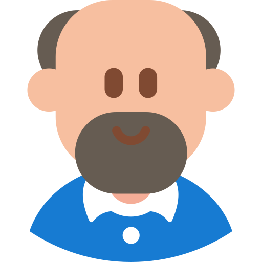

# dev-team-agents

A dev team of coding agents for building your own project, with a live dashboard of who is talking to whom.
It runs on [Claude Code](https://claude.com/claude-code) and needs Node.js for the dashboard and logging.

## The team

| Persona | Role | Does |
| --- | --- | --- |
| &nbsp;Dave | Dev manager | Takes your objectives, plans missions, hands them out, enforces the workflow |
| &nbsp;Adam | Architect, security owner | Architecture decisions, one design meeting with the team, reviews Alice's code, security check of every mission |
| &nbsp;Alice | Senior developer | Hard missions, reviews Ben's code |
| &nbsp;Ben | Junior developer | Simple missions |
| &nbsp;Tom | QA | Writes the test book from the spec, tests every mission |
| &nbsp;Alex | Documentation | Documents a mission after it is merged |

## Use it

1. Use this repo as a template for your project (or copy `.claude/` and `team/` into an existing repo).
2. Start the dashboard: `node team/team.js start` and open <http://localhost:4321>.
   It runs in the background; stop it with `node team/team.js stop`. Both take an optional port.
   Use `node team/team.js serve` to run it in the foreground instead.
3. Run `claude` in the repo. The session starts as Dave. Give him your objectives and design.

Dave asks for your approval twice, on the mission plan and on the architecture, and comes back to you
when a mission is rejected three times, a team member has a question nobody can answer, or Adam finds
a security issue in your spec.

## Workflow

1. Dave plans missions, each with acceptance criteria that say what "done" means. You approve.
2. Adam drafts `docs/architecture.md`, gets one round of objections from Alice, Ben and Tom, and finalises it.
   He raises any security issue in your spec as a question for you. You approve.
3. Tom writes `docs/test-book.md` from the spec.
4. Each mission runs on its own `mission/<id>` branch: code, then review (Alice reviews Ben, Adam reviews Alice),
   Adam's security check (packages supported and free of known vulnerabilities, code secure), then Tom's tests:
   the mission's cases and a full regression run, so a mission cannot break an earlier one.
   The developer commits only after all of them pass, and Dave merges to main.
5. Alex documents the merged mission.
6. After the last mission, a final pass on main: Tom runs the complete test book and Adam checks the
   security of the whole codebase and its dependencies. Anything found becomes a fix mission.

Reviewers record recurring rejection reasons in `docs/conventions.md`, and developers read it before
coding, so the same mistake is not repeated in every mission.

## Files

- `.claude/agents/*.md`: one file per persona. Edit these to change behaviour, the model each one uses or
  its `tools`. Developers and QA are limited to file, search and shell tools, so they cannot reach
  connectors such as email or calendar.
- `.claude/settings.json`: makes Dave the main session and installs the logging hooks.
- `team/team.js`: event logger, hook handler and dashboard server (`start`, `stop`, `serve`).
- `team/icons/`: the app icon and one avatar per persona, used by the dashboard and this README.
- `team/tasks.json`: the mission board, kept by Dave. A new session resumes from it.
- `team/events.jsonl`: the interaction log the dashboard renders.
- `node team/test.js`: checks the logger.
